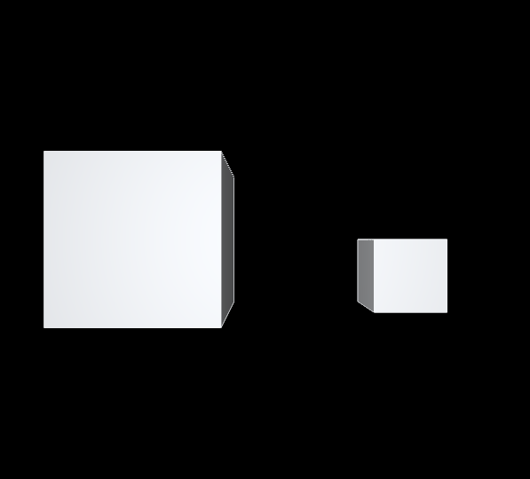
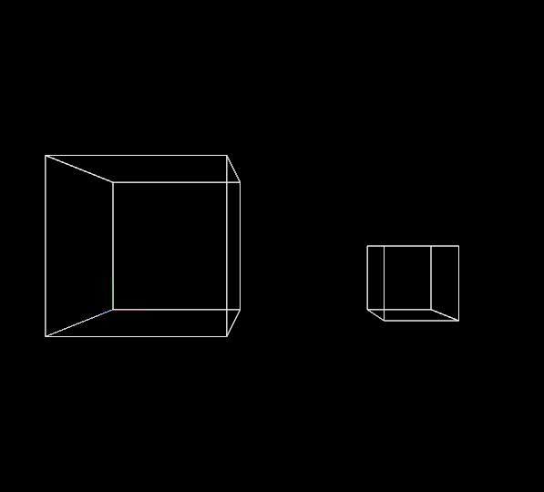
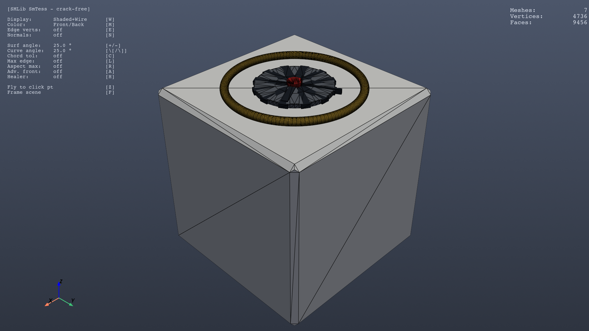
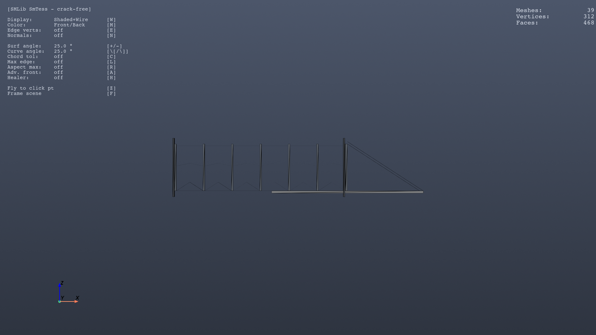

# usd-brep на Linux: сборка, запуск и грабли

Практическое руководство по сборке [NVIDIA usd-brep](https://github.com/NVIDIA-Omniverse/usd-brep)
из исходников на Ubuntu и запуску плагина Hydra `hdUsdBrep` в `usdview`.

Плюс рабочие примеры: CAD-геометрия из Python и полный чертёж ворот.

**Это не форк.** Здесь нет кода NVIDIA — только русские заметки о сборке,
скрипт проверки и примеры, которые я написал сам.

---

## Зачем это

Официальный репозиторий собирается без проблем, но запуск упирается в четыре
неочевидные вещи, на которых легко потерять полдня:

1. `hdUsdBrep` не рисует BRep в `usdview` — скрипт запуска забывает путь
   к плагинам самого OpenUSD.
2. Qt на Wayland не создаёт GL-контекст.
3. PyOpenGL по умолчанию выбирает EGL, конфликтуя с GLX-контекстом Qt.
4. `OMNISOLID_PLUGIN_PATH` должен указывать на папку с `plugInfo.json`.

Все четыре разобраны ниже с точными сообщениями об ошибках.

---

## Быстрая проверка, что всё живо

```bash
cp scripts/check_usdbrep.sh /path/to/usd-brep/
cd /path/to/usd-brep
DISPLAY=:1 ./check_usdbrep.sh
```

Скрипт проверяет шесть слоёв по отдельности и возвращает число провалов
как код выхода:

| Слой | Что доказывает |
|---|---|
| 1. Артефакты | библиотеки собраны |
| 2. Геометрия | ядро считает правильно (объём коробки ровно 1000) |
| 3. USD-мост | экспорт/импорт не теряет грани |
| 4. Плагин Hydra | три типа плагина зарегистрированы |
| 5. Тесты плагина | адаптер строит Hydra-сцены (6 проверок) |
| 6. GPU-рендер | Storm действительно рисует BRep |

Он сам выставляет всё окружение, поэтому его можно запускать откуда угодно.

---

## Сборка без sudo

Ни один шаг не требует root. Недостающее ставится локально:

```bash
# git-lfs — бинарником
curl -sL -o /tmp/git-lfs.tar.gz \
  https://github.com/git-lfs/git-lfs/releases/download/v3.5.1/git-lfs-linux-amd64-v3.5.1.tar.gz
mkdir -p /tmp/gitlfs ~/.local/bin
tar -xzf /tmp/git-lfs.tar.gz -C /tmp/gitlfs --strip-components=1
cp /tmp/gitlfs/git-lfs ~/.local/bin/ && chmod +x ~/.local/bin/git-lfs
git lfs install --skip-repo

# clang-format — колесом в venv
python3.12 -m venv /tmp/toolsvenv
/tmp/toolsvenv/bin/pip install clang-format==18.1.8
```

Дальше штатно:

```bash
git clone https://github.com/NVIDIA-Omniverse/usd-brep.git
cd usd-brep
./prebuild.sh      # ~100 с, тянет OpenUSD/Python/pybind11 через Packman
./repo.sh build    # ~90 с на 32 ядрах, ~1.3 ГБ
./repo.sh test     # полный набор, ожидается EXIT 0
```

---

## Обязательное окружение

Без этого ничего не запустится:

```bash
B=$PWD
U=$B/_build/target-deps/usd/release

export PYTHONPATH="$B/_build/linux-x86_64/release:$U/lib/python"
export LD_LIBRARY_PATH="$B/_build/linux-x86_64/release:$U/lib:$B/_build/target-deps/python/lib"
export OMNISOLID_PLUGIN_PATH="$B/_build/schema/omniSolid/resources"
export PXR_PLUGINPATH_NAME="$OMNISOLID_PLUGIN_PATH:$B/_build/linux-x86_64/release/plugins/hdUsdBrep:$U/plugin/usd"
export QT_QPA_PLATFORM=xcb
export PYOPENGL_PLATFORM=glx
export HDGP_INCLUDE_DEFAULT_RESOLVER=1
export DISPLAY=:1
```

### GUI-зависимости

```bash
$B/_build/target-deps/python/bin/python3 -m pip install \
    --break-system-packages PySide6 PyOpenGL

# libxcb-cursor0 без sudo (нужен Qt xcb-плагину)
cd /tmp && apt-get download libxcb-cursor0
mkdir -p xcblib && dpkg-deb -x libxcb-cursor0_*.deb xcblib
mkdir -p ~/.local/lib/usdview-extra
cp -P xcblib/usr/lib/x86_64-linux-gnu/*.so* ~/.local/lib/usdview-extra/
# и добавить ~/.local/lib/usdview-extra в LD_LIBRARY_PATH
```

---

## Четыре грабли

### 1. `No renderer plugins found!`

Скрипт `tools/scripts/usdview_hdusdbrep.py` выставляет `PXR_PLUGINPATH_NAME`
только для схемы и плагина `hdUsdBrep`, но **не добавляет `$USD/plugin/usd`**,
где лежит `hdStorm`. Без него рендерера нет.

Решение: добавить `$U/plugin/usd` в `PXR_PLUGINPATH_NAME` **до** запуска.

### 2. `QEGLPlatformContext: Failed to create context: 3009`

Qt идёт через Wayland-EGL, а GL-контекст в этой среде не создаётся.

Решение: `QT_QPA_PLATFORM=xcb` (через XWayland).

### 3. `Attempt to retrieve context when no valid context`

Коварный случай: `glGetString` возвращает `4.6.0 NVIDIA`, всё выглядит живым,
но рендер падает на каждом кадре. PyOpenGL выбрал **EGL**-платформу, а Qt
создал **GLX**-контекст — `eglGetCurrentContext()` возвращает NULL.

Решение: `PYOPENGL_PLATFORM=glx`.

### 4. `RegisterPlugins returned empty vector`

`OMNISOLID_PLUGIN_PATH` должен указывать на **папку с `plugInfo.json`**,
то есть на `.../omniSolid/resources`, а не на её родителя.

---

## Известная особенность: одиночное тело не рисуется

Воспроизводится стабильно в `testusdview` и в интерактивном `usdview`:

| Содержимое файла | Рендерится |
|---|---|
| одна коробка через `export_brep` | **нет** |
| одна коробка через `export_breps([box])` | **нет** |
| две коробки | да |
| два тела в одном `BrepArray` | да |

Причём файлы идентичны побайтово (md5 совпадает), сделаны одной командой
из теста репозитория. Проблема не во входном файле, а в обработке
`BrepArray` с одним телом в адаптере Hydra.

Собственный тест репозитория этого не ловит: его фикстура содержит два тела.

**Обход:** пока нужен один объект — добавьте второе тело.

---

## Примеры

### Сложные оболочки




Wireframe показывает **рёбра точной геометрии**, а не диагонали тесселяции —
это главный признак, что работает именно плагин.

### Часы-дайс (`examples/clock_dice.py`)

Демонстрация конвейера: примитивы → фаски → экструзия → UNION → тесселяция → USD.



```bash
uv run --locked --group gui python examples/clock_dice.py
```

### Откатные ворота 5500 мм (`examples/gates.py`)



Полная конструкция по чертежу: столбы, направляющая 80×40, 8 стоек
с шагом 927, раскосы 33°, перемычки 12°, хвост-треугольник из 2475 мм.
39 тел, все манифолдные.

```bash
uv run --locked --group gui python examples/gates.py
```

Готовая модель: `assets/Gates_5500.usda`

---

## Что выяснено про API

Три вещи, которые не очевидны из документации:

- **`create_rectangle` центрирует контур** на origin, а не строит от него.
  Для бруса, начинающегося в точке, контур надо сдвигать на половину длины.
- **`sm.scale` масштабирует вокруг мирового нуля**, а не локально. Длину
  детали задавайте сразу при построении профиля.
- **`boolean_union` падает с `SM_ERR`** на пересекающихся брусьях. Раму
  из сварных узлов собрать одним UNION не получится — делайте отдельные тела.

Ещё: `fillet_edges` на всех 12 рёбрах куба ломает тело (возвращает успех,
но объём становится нулевым). Для фасок используйте `chamfer_fillet(brep, radius=...)` —
он берёт все рёбра сразу и остаётся манифолдным.

---

## Проверено на

- Ubuntu 24.04, x86_64, 32 ядра
- NVIDIA RTX 4090, драйвер 580.178.04
- Wayland + XWayland
- OpenUSD 25.11, Python 3.12.12

`./repo.sh test` → `EXIT 0`, `failed: 0`, 415+ тестовых случаев.
GPU-тест плагина: `PASS: native-GPU Storm rendering`.

**Не проверено:** debug-конфигурация, OCCT-обмен с внешними `.brep`
(папка фикстур пуста), macOS, aarch64.

---

## Лицензия

MIT для содержимого этого репозитория.

Код NVIDIA usd-brep распространяется под Apache-2.0 — см. их репозиторий.
Примеры здесь написаны с нуля, но используют публичный Python API
`_omni_solid`, а `scripts/check_usdbrep.sh` рассчитан на их структуру каталогов.

---

## Ссылки

- [NVIDIA-Omniverse/usd-brep](https://github.com/NVIDIA-Omniverse/usd-brep) — исходный репозиторий
- [Пакет usd-brep на PyPI](https://pypi.org/project/usd-brep/) — если сборка не нужна
- [Схема UsdSolidBrep](https://github.com/NVIDIA-Omniverse/usd-brep/tree/main/proposals/UsdSolid) — описание схемы
